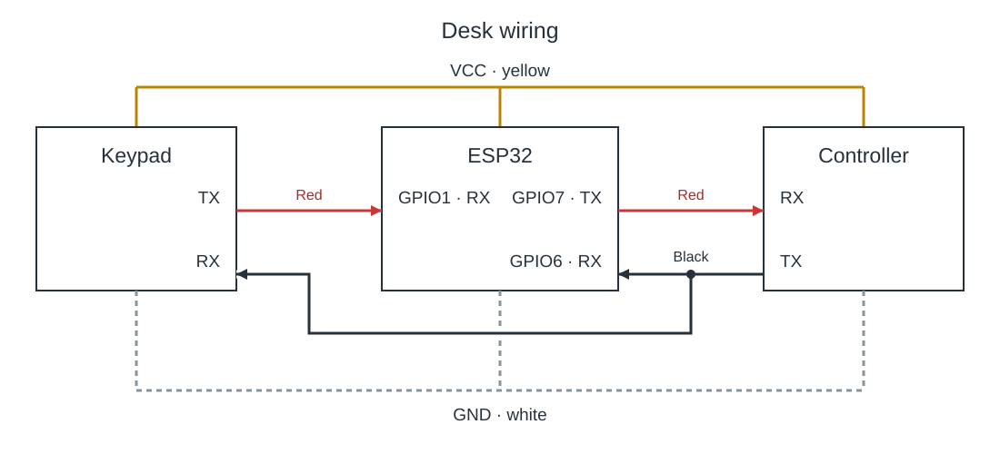

# Standing desk

ESP32-C3 Super Mini firmware that connects a standing desk keypad to its motor
controller. It relays keypad commands, reads the current height, and accepts
height targets over Bluetooth or USB.

Automatic moves wait for fresh height feedback, then stop at the target.
Pressing a physical keypad button or disconnecting Bluetooth cancels the move.
Feedback, progress, and travel timeouts stop an unresponsive move. Heights and
timing limits are configured in `Config.h`.

## Wiring

Both UARTs use 9600 baud, 8N1. The keypad UART receives only; controller
replies reach the keypad directly.



| Connection | ESP32 GPIO |
| --- | --- |
| Keypad TX → ESP32 RX | 1 |
| Controller TX → ESP32 RX **and keypad black/RX** | 6 |
| ESP32 TX → controller RX | 7 |

Keypad colours are red TX, black RX, yellow VCC and white GND.
On the standard Super Mini layout, GPIO1 and GPIO6/7 are on opposite edges.
Place the board across the breadboard's centre gap; A–E and F–J are separate
groups within each numbered row. [Config.h](Config.h) defines pin assignments.

The ESP32 shares the desk cable's VCC and ground. Debug output uses native USB.

## Build

Use Arduino ESP32 core **3.3.12**, board **ESP32C3 Dev Module**, with
**USB CDC On Boot** enabled. No additional libraries are required.

```sh
arduino-cli compile --fqbn esp32:esp32:esp32c3:CDCOnBoot=cdc \
  --build-path /tmp/desk-build firmware
```

Run the command from the repository root, or open `firmware.ino` in Arduino
IDE to build and upload.

## Control

Desky connects to the Bluetooth device **Standing Desk**. The service publishes
height as one binary byte in centimeters and status as `IDLE`, `MOVING`, or
`ERROR`; targets are one binary byte from 72 to 118. UUIDs are in `Config.h`.

For USB control, open the serial monitor at 115200 baud with newline endings.
Send a height such as `100`, `q` to query height, or `s` to stop.
